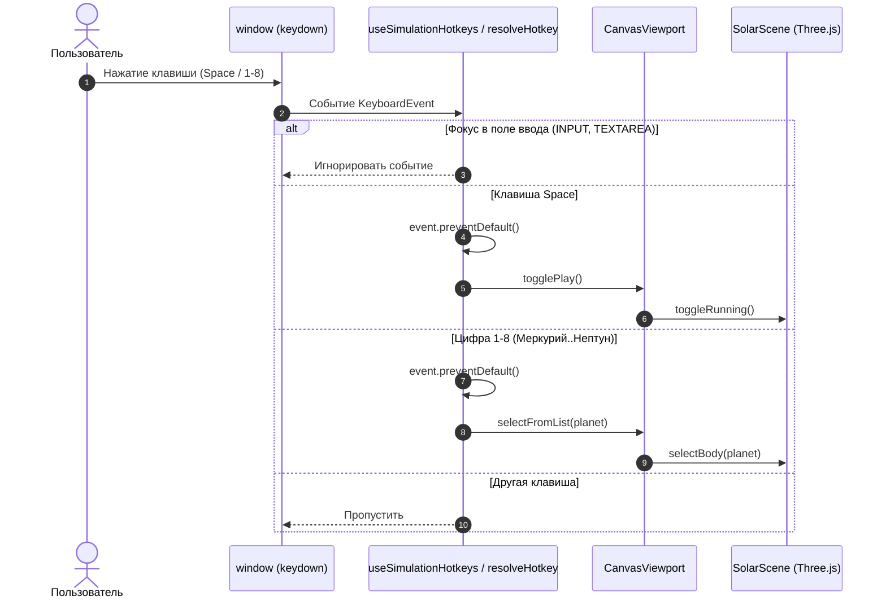

# Design

## Context

В приложении `CanvasViewport.vue` сосредоточены реактивные состояния симуляции: `isPlaying`, `selectedBody`, и методы `togglePlay`, `selectFromList`, `resetView`. Планеты определены в массиве `PLANETS_DATA` (`src/data/celestialBodies.ts`), упорядоченном по возрастанию расстояния от Солнца:
1. Mercury (Меркурий)
2. Venus (Венера)
3. Earth (Земля)
4. Mars (Марс)
5. Jupiter (Юпитер)
6. Saturn (Сатурн)
7. Uranus (Уран)
8. Neptune (Нептун)

В шапке находится строка поиска (`<input class="search-input">`).

## Goals / Non-Goals

**Goals:**
- Выделить обработку горячих клавиш в изолированную чистую логику (composable `useKeyboardShortcuts` или хелпер `handleHotkeyKeydown`), которую легко протестировать юнит-тестами.
- Обеспечить надежное игнорирование горячих клавиш, если событие произошло в поле ввода (`input`, `textarea`, `isContentEditable`).
- Предотвратить дефолтное поведение браузера для `Space` (скролл страницы), вызывая `event.preventDefault()`, когда событие обработано как хоткей.
- Поддерживать цифры с основной клавиатуры (`Digit1`–`Digit8`) и Numpad (`Numpad1`–`Numpad8`).

**Non-Goals:**
- Пользовательская кастомизация раскладки горячих клавиш (сохранение в LocalStorage).
- Клавиатурная навигация внутри списков (стрелки вверх/вниз).

## Decisions

### Решение 1: Вынесение логики распознавания хоткеев в composable/утилиту
- **Выбор:** Создать `src/composables/useSimulationHotkeys.ts` или функцию `resolveSimulationHotkey(event: KeyboardEvent): HotkeyAction | null`.
- **Обоснование:** Позволяет написать четкие Vitest-тесты на проверку нажатия клавиш без мокирования всего WebGL Canvas и Three.js.
- **Альтернативы:** Прописать обработчик прямо в `<script setup>` в `CanvasViewport.vue`. Это снизило бы тестируемость и захламило компонент.

### Решение 2: Обработка полей ввода
- **Выбор:** Проверять `target`: если `target instanceof HTMLElement && (target.tagName === 'INPUT' || target.tagName === 'TEXTAREA' || target.isContentEditable)`, прерывать обработку.
- **Обоснование:** Стандартный и надежный способ избежать перехвата нажатий при вводе запроса в строке поиска или возможных будущих полях формы.

### Решение 3: Маппинг клавиш 1-8
- **Выбор:** Использовать `event.code` (`Digit1`..`Digit8`, `Numpad1`..`Numpad8`) или `event.key` в диапазоне `'1'`..`'8'`. `PLANETS_DATA[index - 1]` обеспечивает точное соответствие 1-Меркурий ... 8-Нептун.
- **Обоснование:** Использование `event.key` в диапазоне `['1'..'8']` устойчиво к раскладке клавиатуры (RU/EN).

## Risks / Trade-offs

- **[Риск]** Перехват `Space` может помешать прокрутке, если на странице появятся длинные прокручиваемые модальные окна.
  - **Mitigation:** Вызывать `event.preventDefault()` только если фокус не на прокручиваемых элементах ввода и шторках.
- **[Риск]** Утечка слушателя событий при размонтировании.
  - **Mitigation:** Обязательное удаление слушателя `window.removeEventListener('keydown', ...)` в `onBeforeUnmount` (или автоматически через composable).
