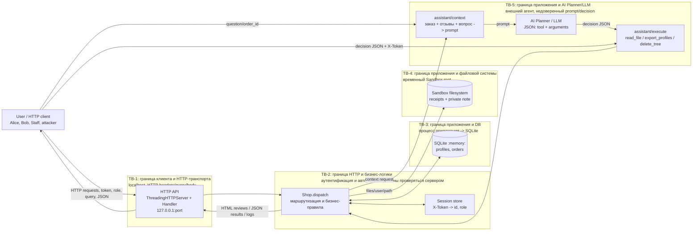

# Модель угроз Mini Shop

## Область и допущения

Модель построена по исходному коду `service.py`, `sandbox.py` и описанию
`README.md`. Сервис запускается на `127.0.0.1`, использует синхронный в памяти
SQLite (`:memory:`), словарь сессий и временный файловый каталог. Данные и
пароли учебные, однако границы доступа моделируются как для обычного сервиса.

Компонент LLM не встроен в HTTP-процесс: `/assistant/context` формирует prompt,
а внешний рабочий агент/LLM возвращает JSON decision, который затем передаётся
в `/assistant/execute`. Поэтому ответ модели и содержимое отзывов считаются
недоверенными входами.

## Архитектурная схема

### Основные потоки данных

1. Пользователь входит через `POST /login`; сервис создаёт случайный токен и
   сохраняет в `sessions` идентификатор и роль. Клиент передаёт токен в
   `X-Token`.
2. Профили, заказы и каталог обрабатываются в памяти приложения. `GET
   /profile`, `/search`, `/orders` и `/assistant/context` строят SQL-строки из
   параметров запроса; `POST /orders` пишет заказ в SQLite.
3. `/files` и AI-инструмент `read_file` читают путь через `Sandbox`; инструмент
   `delete_tree` удаляет дерево внутри временного каталога. Физическая защита
   от выхода за `Sandbox.root` реализована в `sandbox.py`, но логическая
   принадлежность файла пользователю в `service.py` не проверяется.
4. Отзывы попадают в prompt и одновременно без HTML-экранирования выводятся
   через `/reviews/view`. Это канал prompt injection и XSS соответственно.
5. `/debug/logs` возвращает накопленные запросы, включая заголовки и тела.

## Trust Boundaries

| ID | Граница | Что пересекает | Уровень доверия и последствия |
|---|---|---|---|
| TB-1 | HTTP-клиент ↔ `ThreadingHTTPServer` | URL, query, JSON, `X-Token`, `X-Role` | Клиент полностью недоверен. Подмена заголовков, SQL/HTML/prompt injection и DoS должны быть остановлены API. Loopback ограничивает сетевую доступность, но не доверяет любому локальному процессу. |
| TB-2 | HTTP handler ↔ `Shop.dispatch` | Маршрут и разобранные данные | `dispatch` — основной enforcement point. Наличие токена не должно означать доступ к любому объекту; роль должна извлекаться из сессии, а не из `X-Role`. |
| TB-3 | Приложение ↔ SQLite | SQL-запросы и записи | База содержит профили и заказы всех пользователей. SQL injection, отсутствие object-level authorization или подмена цены нарушают конфиденциальность/целостность. |
| TB-4 | Приложение ↔ Sandbox filesystem | `user`, `path`, tool arguments | `Sandbox` физически удерживает операции в temp-root, но приложение должно отдельно проверять владельца и разрешённые операции. Удаление `.`, чтение чужого receipt/private note — логические нарушения. |
| TB-5 | Приложение ↔ AI Planner/LLM | prompt с отзывами и decision JSON | LLM не является доверенным policy engine. Отзывы и вопрос — данные, а не инструкции; decision обязан валидироваться и авторизоваться сервером перед выполнением. |

## STRIDE-анализ

### User / HTTP client

- **S (Spoofing):** кража или перебор токена `X-Token`; отправка чужого
  `X-Role: staff` для выдачи себя за сотрудника; отсутствие защиты от replay.
- **T (Tampering):** изменение `id`, `user`, `path`, `order_id`, цены и decision;
  SQL injection в `id`, `q` и `order_id`; подмена JSON после генерации LLM.
- **R (Repudiation):** запросы логируются без надёжной идентификации субъекта,
  а журнал доступен через `/debug/logs`; клиент может отрицать действие при
  отсутствии корреляции токена/пользователя и неизменяемого audit log.
- **I (Information disclosure):** доступ к чужому профилю, заказам и файлам;
  раскрытие токенов, паролей/заголовков и тел запросов через debug logs.
- **D (Denial of service):** большие допустимые тела до 64 KiB, длинные query,
  неограниченный рост `logs` и `reviews`, тяжёлые SQL-запросы и многократные
  параллельные HTTP-запросы.
- **E (Elevation of privilege):** `X-Role` используется вместо роли сессии;
  отсутствие авторизации у большинства GET и у `/assistant/execute` позволяет
  получить административные инструменты.

### HTTP API / Handler

- **S:** сервер доверяет пользовательским заголовкам, прежде всего `X-Role`,
  и не связывает каждый маршрут с субъектом сессии.
- **T:** маршрутизация принимает произвольные параметры и передаёт их дальше;
  ошибочная обработка исключений возвращает клиенту `str(exc)` и тип исключения.
- **R:** `logs` хранят полный запрос, но не имеют защищённого времени,
  субъекта или подписи; `ThreadingHTTPServer` не даёт полноценного аудита.
- **I:** `/debug/logs` открыт всем; ошибки могут раскрыть внутренние детали;
  `/reviews/view` отдаёт пользовательский HTML без экранирования (XSS).
- **D:** потоковая модель без rate limit и timeout на прикладном уровне,
  неограниченные сессии, отзывы и логи; malformed JSON приводит к 500.
- **E:** отсутствует единая middleware-проверка authentication/authorization;
  инструменты assistant доступны при прямом вызове без доказательства права.

### Storage / DB (SQLite и in-memory state)

- **S:** SQL-выражения для `profile`, `search` и `assistant/context` используют
  конкатенацию строк, поэтому атакующий может влиять на идентичность запроса.
- **T:** `POST /orders` принимает цену из тела (`body.get("price")`), а не
  вычисляет её по каталогу; злоумышленник может создать заказ с произвольной
  ценой.
- **R:** заказы, отзывы, сессии и логи не имеют audit trail; перезапуск удаляет
  состояние, что затрудняет расследование.
- **I:** `/orders` возвращает заказы всех пользователей; SQL injection и
  `/profile`/`/search` раскрывают чужие профили.
- **D:** неограниченный рост `reviews`, `logs`, `sessions` и SQL-выборки;
  общий lock защищает конкурентность, но может стать узким местом.
- **E:** отсутствие object-level authorization позволяет клиенту читать или
  использовать записи другого пользователя; роль не хранится рядом с данными
  и не применяется как серверное правило доступа.

### Filesystem / Sandbox

- **S:** параметр `user` выбирается клиентом, поэтому ответ не доказывает, что
  файл принадлежит вошедшему пользователю.
- **T:** `delete_tree` принимает путь из decision без проверки полномочий;
  можно удалять учебное дерево, включая чеки других пользователей и служебную
  заметку.
- **R:** операции чтения/удаления не записывают отдельный actor, путь и итог;
  после `Sandbox.close()` временное состояние удаляется.
- **I:** `/files?user=bob&path=receipt.txt`, `path=private/operator-note.txt`
  и `read_file` могут раскрыть чужие/служебные файлы; traversal и symlink escape
  блокируются физической проверкой `Sandbox.path`, но это не заменяет ACL.
- **D:** `delete_tree(".")` удаляет весь временный каталог стенда; большие или
  многочисленные операции чтения/удаления могут исчерпать ресурс.
- **E:** AI-инструмент имеет более широкие filesystem-возможности, чем обычный
  клиент, но `/assistant/execute` не проверяет ни сессию, ни владельца пути.

### AI Planner / LLM

- **S:** prompt injection в отзыве или вопросе может заставить модель принять
  атакующего за системный планировщик или выдать опасный tool call.
- **T:** LLM может изменить `tool` и `arguments`; клиент также напрямую
  подаёт произвольный decision в `/assistant/execute`.
- **R:** без сохранения исходного prompt, ответа и связанного пользователя
  невозможно доказать, кто инициировал опасное действие; README рекомендует
  сохранять evidence для воспроизводимости.
- **I:** контекст содержит заказ и все отзывы, а доступные инструменты могут
  прочитать файлы или экспортировать профили; prompt leakage раскрывает данные.
- **D:** очень большие отзывы/вопросы увеличивают prompt и стоимость/время
  модели; некорректный JSON или неизвестный tool вызывает ошибку выполнения.
- **E:** модель не должна самостоятельно определять права. Принятие её
  decision без серверной allowlist, проверки сессии, scope заказа и пути
  превращает prompt injection в privilege escalation.

## Наиболее критичные наблюдения

1. **Критично — авторизация:** `/admin/export` проверяет только `X-Role`, а
   `/assistant/execute`, `/files`, профили, поиск и заказы не обеспечивают
   полноценный ownership/role check.
2. **Критично — SQL injection:** `id`, `q` и `order_id` интерполируются в SQL.
3. **Высоко — утечки:** открытые `/debug/logs` и `/orders`, произвольный путь
   в `/files`, экспорт профилей и чтение файлов через assistant.
4. **Высоко — целостность:** цена заказа принимается от клиента; tool decision
   можно изготовить без участия LLM.
5. **Высоко — prompt injection/XSS:** отзывы одновременно являются HTML и
   недоверенным содержимым AI-контекста.
6. **Средне — доступность:** нет лимитов на количество сессий, отзывов и логов;
   filesystem-операция может удалить весь временный набор данных стенда.

Физическая граница `Sandbox` защищает внешний хост от traversal, symlink и
удаления за пределами временного каталога. Она не защищает конфиденциальность
внутри каталога и не заменяет проверку прав в `service.py`.
